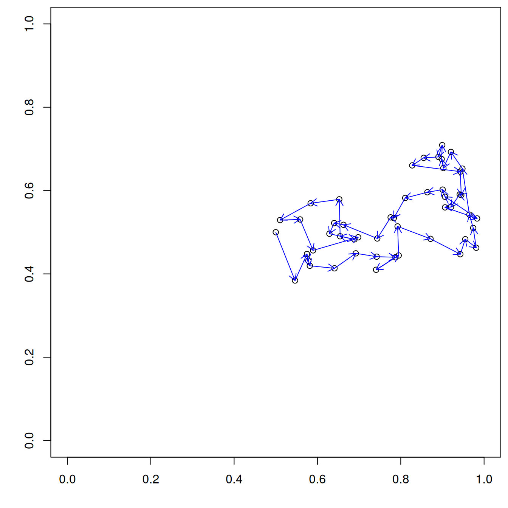
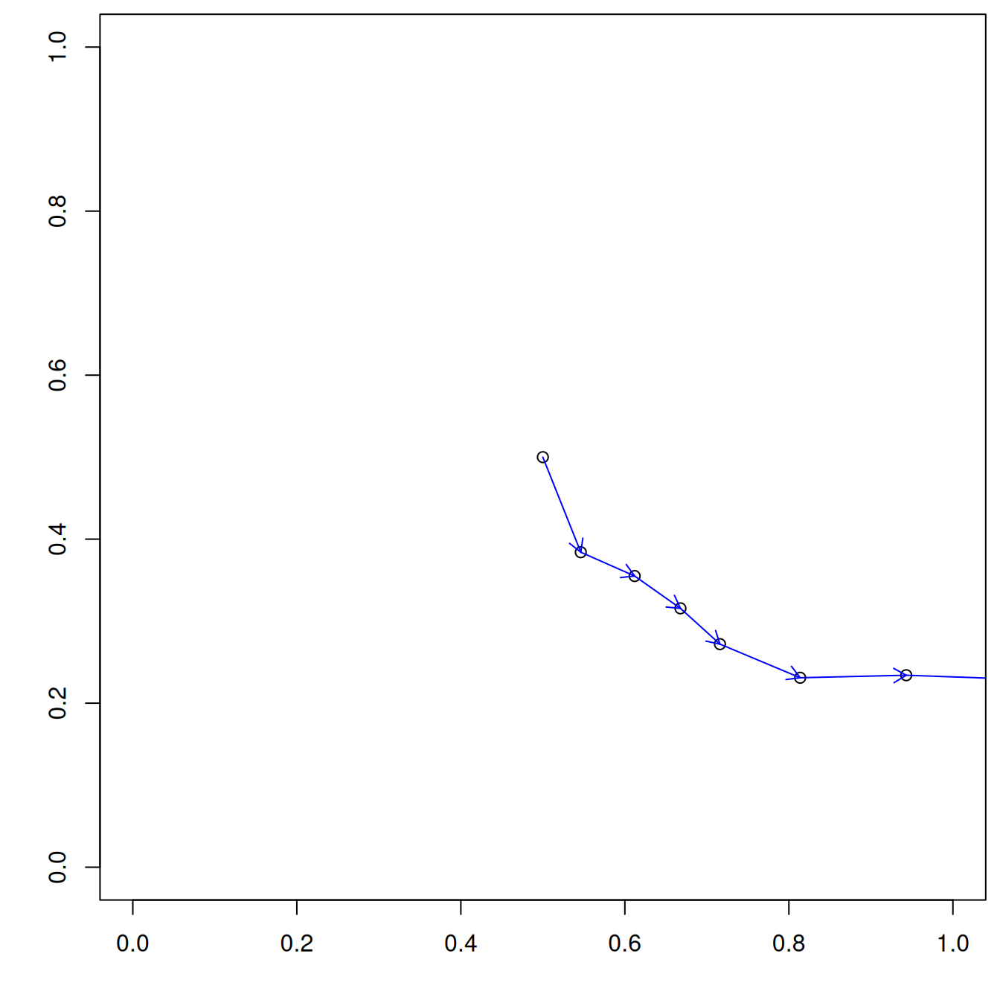

# Overview {visibility="hidden"}

## Movement models


::: {.hidden}
$$
 \def\RR{{\bf R}}
 \def\bold#1{{\bf #1}}
 \def\but{{\boldsymbol u_t}}
 \def\butp{{\boldsymbol u_{t+1}}}
 \def\beps{{\boldsymbol \varepsilon}}
$$
:::


- Random walks
  * Simple random walk
  * Correlated random walk
  * Biased random walk
  * PDE

- Point process models
  * Step-selection models


::: {.notes}
Speaker notes go here.
:::


# Random walks

## Simple random walk

$$
  {\boldsymbol u_{t+1}} = \but + \beps
$$

where

$$
  {\boldsymbol \varepsilon} = \text{Norm}(0, \sigma^2 {\bf I})
$$

## Simple random walk simulation {.smaller}


:::: {.columns}

<!-- <br> -->


::: {.column width="45%"}

<br>


```{r, echo=-1}
#| label: rw-simple
#| attr-source: 'style="font-size: 0.85em;"'
#| code-block-bg: true

set.seed(4887730)
sigma <- 0.05
T <- 50
u <- matrix(NA, nrow=T, ncol=2)
u[1,] <- c(0.5,0.5)
for(t in 2:T) {
  epsilon <- rnorm(n=2, mean=c(0,0), sd=sigma)
  u[t,] <- u[t-1,] + epsilon
  ## Equivalent to two lines above
  ## u[t,] <- rnorm(n=2, mean=u[t-1,], sd=0.05)  
}
```

<br>


```{r, echo=-1}
#| label: fig-rw-simple
#| attr-source: 'style="font-size: 0.85em;"'
#| fig-width: 7
#| fig-height: 7
#| fig.show: hide

par(mai=c(0.7,0.7,0.1,0.1))
plot(u, asp=1, xlim=c(0,1), ylim=c(0,1),
     xlab="", ylab="")
arrows(u[1:49,1], u[1:49,2],
       u[2:50,1], u[2:50,2], length=0.1,
       col="blue")

```

:::

::: {.column width="54%"}

{fig-align="top" width="100%"}

:::

::::


## Biased random walk


\begin{equation}
  {\boldsymbol u_{t+1}} = \but + {\bf B}(\but-{\boldsymbol s}) + \beps
  \label{eq:brwalk}
\end{equation}

where, typically:

$$
\begin{equation}
  {\bf B}	= 
  \begin{pmatrix}
    \rho & 0 \\
    0    & \rho
  \end{pmatrix}
\end{equation}
$$

with $\rho \in [0,1]$


## Biased random walk simulation


<!-- <br> -->

:::: {.columns}

<!-- <br> -->


::: {.column width="50%"}

<br>


::: {style='font-size: 70%;'}

```{r, echo=-(1:2)}
#| label: brw-simple
#| fig-width: 7
#| fig-height: 7
#| fig-show: hide

## #| attr-source: 'style="font-size: 0.85em;"'
set.seed(4887730)
sigma <- 0.05
rho <- 0.1        # Bias towards activity center
T <- 50
u <- matrix(NA, nrow=T, ncol=2)
u[1,] <- c(0.5,0.5)
s <- c(0.5,0.5)
B <- diag(rho,2)
for(t in 2:T) {
  epsilon <- rnorm(n=2, mean=c(0,0), sd=sigma)
  u[t,] <- u[t-1,] + B%*%(s-u[t-1,]) + epsilon
}

par(mai=c(0.7,0.7,0.1,0.1))
plot(u, asp=1, xlim=c(0,1), ylim=c(0,1),
     xlab="", ylab="")
points(s[1], s[2], pch=16, col=rgb(0,0,1,0.5),
       cex=2.5)
arrows(u[1:49,1], u[1:49,2],
       u[2:50,1], u[2:50,2], length=0.1,
       col="blue")

```

:::
:::

::: {.column width="50%"}

{width="100%"}


:::

:::


## Correlated random walk

\begin{equation}
  \butp = \but + {\bf R}(\but-{\boldsymbol u}_{t-1}) + \beps
  \label{eq:crwalk}
\end{equation}

where

$$
  {\bf R} = \gamma
  \begin{pmatrix}
    \cos(\theta) & -\sin(\theta) \\
    \sin(\theta) & \cos(\theta) 
  \end{pmatrix}
$$
with $\theta \in [-\pi,\pi]$ being the expected turn angle, and
$\gamma \in [0,1]$ dampening the persistence. 


## Correlated random walk simulation


::: {.columns}

<!-- <br> -->


::: {.column width="50%"}

<br>


::: {style='font-size: 70%;'}

```{r, echo=-1}
#| label: fig-crw-simple
#| fig-width: 7
#| fig-height: 7
#| fig-show: hide

## #| attr-source: 'style="font-size: 0.85em;"'
set.seed(4887730)
sigma <- 0.05
gamma <- 0.8      ## Damping of correlated walk
theta <- 0        ## Correlation (-pi,pi)
T <- 50
u <- matrix(NA, nrow=T, ncol=2)
u[1,] <- c(0.5,0.5)
u[2,] <- rnorm(2, u[1,], sd=0.05)
R <- gamma*matrix(c(cos(theta),sin(theta),
                    -sin(theta),cos(theta)),
                  nrow=2, ncol=2)
for(t in 3:T) {
  epsilon <- rnorm(n=2, mean=c(0,0),
                   sd=sigma)
  u[t,] <- u[t-1,] + R%*%(u[t-1,]-u[t-2,]) +
      epsilon
}
par(mai=c(0.7,0.7,0.1,0.1))
plot(u, asp=1, xlim=range(u[,1]),
     ylim=range(u[,2]),
     xlab="", ylab="")
arrows(u[1:49,1], u[1:49,2],
       u[2:50,1], u[2:50,2], length=0.1,
       col="blue")
```
:::

:::

::: {.column width="50%"}

{width="100%"}


:::

:::


## [Random walks along environmental gradients]{style="font-size: 80%;"}


::: {style='font-size: 80%;'}
$$
  \butp = \but + {\bf D}\nabla x(\but) + \beps
$$

where $\bf D = \alpha {\bf I}$ is a $2\times2$ matrix describing the
effect of the gradient in the environment ($\nabla x$) at location
$\but$. 

<br>


::: {.fragment}

Positive values of $\alpha$ describe the scenario in which the
organism tends to move in the direction of the gradient. If
$\alpha=0$, the individual will ignore the environment as it follows a
simple random walk.
:::

:::


## Environment

::: {style='font-size: 80%;'}

```{r}
#| label: pde
set.seed(430)
library(terra)
delta <- 0.025                          ## Resolution
grid0 <- seq(delta/2, 1-delta/2, delta)    
grid <- cbind(rep(grid0, each=length(grid0)), rep(grid0, times=length(grid0)))
distmat <- as.matrix(dist(grid))        ## Distance b/w grid points
npixels <- nrow(distmat)
V <- exp(-0.1*distmat)                  ## Covariance
R <- chol(V)
X <- t(R) %*% rnorm(npixels)            ## Gaussian random field
Xr <- rast(cbind(grid, X), type="xyz",      ## Convert to raster
    crs="+proj=utm +zone=17 +datum=NAD83 +units=m +no_defs +type=crs")
terr <- terrain(Xr, v=c("slope","aspect"), unit="radians")  ## Slope and aspect
vfieldU <- terr$slope * sin(terr$aspect)    ## x-coord of arrow head
vfieldV <- terr$slope * cos(terr$aspect)    ## y-coord of arrow head
vfieldData <- cbind(as.data.frame(Xr, xy=TRUE), v1=values(vfieldU), v2=values(vfieldV))
names(vfieldData) <- c("s1","s2","X","v1","v2")
```
:::


## [Simulating random walks along environmental gradients]{style="font-size: 60%;"}


::: {style='font-size: 80%;'}
```{r}
#| label: pde-sim
set.seed(311409)
T <- 50
uERW <- matrix(0.5, T, 2)                   ## Initial location
alpha <- 0.02; D <- diag(alpha,2)                ## Effect of envi gradient
xmin <- ymin <- 0+delta; xmax <- ymax <- 1-delta ## Bounds
enviro <- numeric(T)                        ## Environment along path
enviro[1] <- as.numeric(extract(Xr, uERW[1,,drop=FALSE]))
for(t in 2:T) {
    ulast <- uERW[t-1,,drop=FALSE]
    grad <- as.numeric(c(extract(vfieldU, ulast), extract(vfieldV, ulast)))
    unew <- ulast + t(D%*%grad) + rnorm(2, 0, sigma)
    if(unew[1]<xmin) unew[1] <- xmin+(xmin-unew[1]) ## Reflection at boundary
    if(unew[1]>xmax) unew[1] <- xmax-(unew[1]-xmax)
    if(unew[2]<ymin) unew[2] <- ymin+(ymin-unew[2])
    if(unew[2]>ymax) unew[2] <- ymax-(unew[2]-ymax)
    uERW[t,] <- unew                   ## New location
    enviro[t] <- as.numeric(extract(Xr, unew))     ## Environment at new location
}
```
:::


```{r}
#| label: pde-fig
#| echo: false
#| fig-show: 'hide'
library(lattice)
library(latticeExtra)
colrs <- colorRampPalette(c("#333a7b","#4b6982","#70c6c7","#b4ffd8","#ffffff"), alpha=0.9)
levPlot <- levelplot(X~s1+s2, vfieldData, aspect="iso", col.regions=colrs(100),
                     colorkey=list(space='top', at=seq(min(X),max(X),len=100), width=0.5),
                     xlab="", ylab="", scales=list(draw=FALSE),
##                     par.settings=list(axis.line = list(col = "transparent")),
                     panel=function(...) {
                         panel.levelplot(...)
                         with(vfieldData, larrows(s1, s2, s1+v1*0.02, s2+v2*0.02,
                                                  length=0.02, col=rgb(0,0,0,0.5)))
                         llines(uERW[,1], uERW[,2], col=rgb(1,0,0,0.9), lwd=2)
                     })
wirePlot <- wireframe(X~s1+s2, vfieldData, shade=FALSE, drape=TRUE, col.regions=colrs(100),
                      xlab="",ylab="",zlab="", scales=list(draw=FALSE),
                      x2=uERW[,1], y2=uERW[,2], z2=enviro,
                      col=rgb(0,0,0,0.1),
                      panel.3d.wireframe=function(x,y,z, xlim, ylim, zlim, col,
                                                  xlim.scaled,ylim.scaled,zlim.scaled,
                                                  x2,y2,z2,...) {
                          panel.3dwire(x=x, y=y, z=z, xlim=xlim, ylim=ylim, zlim=zlim,
                                       xlim.scaled=xlim.scaled, ylim.scaled=ylim.scaled,
                                       zlim.scaled=zlim.scaled, col=col, ...)
                          xx <- xlim.scaled[1]+diff(xlim.scaled)*(x2-xlim[1])/diff(xlim)
                          yy <- ylim.scaled[1]+diff(ylim.scaled)*(y2-ylim[1])/diff(ylim)
                          zz <- zlim.scaled[1]+diff(zlim.scaled)*(z2-zlim[1])/diff(zlim)
                          panel.3dscatter(x=xx, y=yy, z=zz, type='l', col=rgb(1,0,0,0.9),
                                          lwd=2, ...) 
                      }, screen=list(z=20,x=-20), zoom=1.01)
plot(c(levPlot,wirePlot))

```


## [Simulating random walks along environmental gradients]{style="font-size: 60%;"}

{width="100%"}


# Point process models
